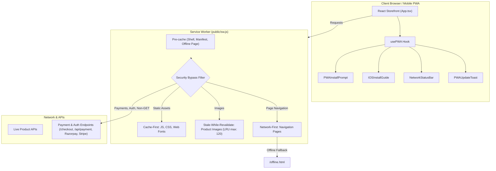

# AURELIA ATELIER — Luxury Prêt-à-Porter & Progressive Web App (PWA)

> An enterprise-grade, high-performance luxury fashion e-commerce storefront engineered with **React 18**, **TypeScript**, **Vite 5**, **Modular SCSS**, and a production-ready **Progressive Web App (PWA)** architecture.

---

## Table of Contents

1. [Architectural Overview & Highlights](#1-architectural-overview--highlights)
2. [Tech Stack & Dependencies](#2-tech-stack--dependencies)
3. [Project Directory Structure](#3-project-directory-structure)
4. [Complete Storefront Pages & Page Functions](#4-complete-storefront-pages--page-functions)
   - [Home Page (`/`)](#home-page-)
   - [Product Listing Page / Catalog (`/shop`, `/category/:slug`, `/new-arrivals`, `/offers`, `/search`)](#product-listing-page--catalog-)
   - [Product Details Page (`/product/:slug`)](#product-details-page-productslug)
   - [Shopping Bag & Cart Drawer (`/cart`)](#shopping-bag--cart-drawer-cart)
   - [Standalone Checkout Flow (`/checkout/*`)](#standalone-checkout-flow-checkout)
   - [Order Success Page (`/order-success`)](#order-success-page-order-success)
   - [Order History & Tracking (`/orders`, `/orders/:id`, `/track-order/:id`)](#order-history--tracking-orders-track-orderid)
   - [Wishlist Page (`/wishlist`)](#wishlist-page-wishlist)
   - [Customer Account Dashboard (`/account`)](#customer-account-dashboard-account)
   - [Authentication Portal (`/login`, `/signup`)](#authentication-portal-login-signup)
   - [Atelier Heritage & Support Static Pages (`/about`, `/contact`, `/faq`, `/returns`, `404`)](#atelier-heritage--support-static-pages)
5. [Progressive Web App (PWA) Architecture](#5-progressive-web-app-pwa-architecture)
   - [Web App Manifest & Metadata](#web-app-manifest--metadata)
   - [Service Worker & Multi-Tier Caching Strategies](#service-worker--multi-tier-caching-strategies)
   - [Strict E-Commerce Security Isolation](#strict-e-commerce-security-isolation)
   - [Native Browser Omnibox & Search Bar Install Options](#native-browser-omnibox--search-bar-install-options)
   - [App-Like UI Components](#app-like-ui-components)
6. [100% Mobile-Friendly & Native Ergonomics Architecture](#6-100-mobile-friendly--native-ergonomics-architecture)
7. [Global Modals & Navigation Components](#7-global-modals--navigation-components)
8. [State Management Architecture (Zustand 5)](#8-state-management-architecture-zustand-5)
9. [Installation & Getting Started](#9-installation--getting-started)
10. [Build & Verification Commands](#10-build--verification-commands)

---

## 1. Architectural Overview & Highlights

- **Standard Web & React Architecture**: Built 100% with standard web technologies (React 18, HTML5, CSS3, Service Workers, Web App Manifest). Zero React Native or hybrid mobile framework dependencies.
- **Pure Modular SCSS Design System**: Zero Tailwind or utility-class bloat. Uses custom SCSS modules with CSS custom properties (`var(--color-primary)`, `var(--font-display)`), responsive breakpoints, and luxury aesthetic design tokens.
- **Installable PWA Experience**:
  - Automatically installable on Android, Windows, macOS, Linux, and iOS Safari.
  - Native browser address bar / Omnibox download option enabled via valid Manifest, Service Worker, and Rich Install screenshots.
  - Prominent "Download App" buttons integrated into the desktop header search bar and interactive search modal.
  - Standalone display mode with custom splash screens, app icons, and theme bar colors (`#121316`).
- **Resilient Offline Architecture**:
  - Pre-cached app shell and offline luxury fallback page (`/offline.html`).
  - Stale-while-revalidate caching for product imagery with automatic LRU cache eviction (max 120 images).
  - Real-time online/offline network detection with luxury status toast notifications.
- **Enterprise E-Commerce Security**:
  - Sensitive operations (`/checkout`, `/api/payment`, `/api/auth`, Razorpay/Stripe gateways) strictly bypass Service Worker caches.
  - Offline checkout and offline simulated order placements are prevented by design.

---

## 2. Tech Stack & Dependencies

| Layer | Technologies & Libraries |
|---|---|
| **Core Framework** | React 18.3.1, TypeScript 5.6.3 |
| **Build Engine** | Vite 5.4.11 with `@vitejs/plugin-react` |
| **Routing** | React Router DOM 6.28.0 (nested layouts, dynamic parameters, catch-alls) |
| **Global State** | Zustand 5.0.1 with LocalStorage persistence (`persist` middleware) |
| **Styling** | Sass / SCSS 1.81.0 (Modular BEM structure, CSS Custom Properties) |
| **Icons & Visuals** | Lucide React 0.460.0, Canvas Confetti 1.9.4 |
| **PWA Stack** | Web App Manifest (`manifest.webmanifest`, `manifest.json`), Service Worker API (`public/sw.js`), CacheStorage API |

---

## 3. Project Directory Structure

```
├── public/
│   ├── favicon.svg                   # Luxury vector gold star favicon
│   ├── index.html                    # Root HTML template with PWA links & Apple meta
│   ├── manifest.json                 # Web App Manifest (Chromium fallback)
│   ├── manifest.webmanifest          # W3C Web App Manifest specification
│   ├── offline.html                  # Branded standalone offline fallback page
│   ├── sw.js                         # Production Service Worker (multi-tier caching)
│   ├── icons/                        # PWA Application icons
│   │   ├── apple-touch-icon.png      # 180×180 iOS Home Screen icon
│   │   ├── icon-192.png              # 192×192 standard launcher icon
│   │   ├── icon-512.png              # 512×512 splash screen & app store icon
│   │   ├── icon-maskable-192.png     # 192×192 maskable icon with safe-zone margin
│   │   ├── icon-maskable-512.png     # 512×512 maskable icon
│   │   └── icon.svg                  # Vector master icon
│   └── screenshots/                  # PWA Rich Install Preview screenshots
│       ├── screenshot-desktop.png    # 1280×800 Desktop preview
│       └── screenshot-mobile.png     # 750×1334 Mobile preview
├── src/
│   ├── App.tsx                       # Central router with all page routes
│   ├── main.tsx                      # Bootstrap entry point & early SW registration
│   ├── types/
│   │   └── index.ts                  # Domain models (Product, Cart, Order, Address, User)
│   ├── stores/                       # Zustand state management
│   │   ├── useAuthStore.ts           # Customer session, login/signup, profile
│   │   ├── useCartStore.ts           # Shopping bag, coupon discounts, price math
│   │   ├── useOrderStore.ts          # Order history, placement, live tracking
│   │   ├── useUIStore.ts             # Search modal, mobile drawer, quick view
│   │   └── useWishlistStore.ts       # Saved creations bookmarking
│   ├── animations/                   # Scroll-triggered animation primitives (index.tsx + index.scss)
│   │   ├── AnimatedCounter/          # Eased number counter for metrics
│   │   ├── MagneticButton/           # Cursor-tracking luxury magnetic button
│   │   ├── PageTransition/           # Smooth route transition wrapper
│   │   ├── Parallax/                 # Scroll-linked depth transform container
│   │   ├── Reveal/                   # Intersection observer (fade, slide, scale)
│   │   ├── ScrollProgress/           # Fixed gold progress indicator
│   │   ├── StaggerGroup/             # Cascading children animation wrapper
│   │   ├── TextReveal/               # Cinematic typography text reveal
│   │   ├── animation.config.ts       # Timing, bezier curves & spring physics presets
│   │   └── index.ts                  # Barrel export
│   ├── pwa/                          # Progressive Web App React integration
│   │   ├── components/               # PWA UI components (index.tsx + index.scss)
│   │   │   ├── IOSInstallGuide/      # Safari Add-to-Home-Screen guide
│   │   │   ├── NetworkStatusBar/     # Online / offline connectivity banner
│   │   │   ├── PWAInstallPrompt/     # Desktop floating prompt & mobile bottom sheet
│   │   │   └── PWAUpdateToast/       # Service worker update notification
│   │   ├── usePWA.ts                 # Lifecycle hook for SW, install prompts, network state
│   │   └── index.ts                  # Barrel export
│   ├── components/
│   │   ├── ui/                       # Design system primitives (index.tsx + index.scss)
│   │   │   ├── Badge/, Button/, Container/, Divider/, EmptyState/, ErrorState/
│   │   │   ├── IconButton/, PriceDisplay/, RatingStars/, Skeleton/, Spinner/, Typography/
│   │   │   └── index.ts
│   │   ├── forms/                    # Form components (index.tsx + index.scss)
│   │   │   ├── Checkbox/, FormField/, PasswordInput/, Select/, TextInput/
│   │   │   └── index.ts
│   │   ├── overlays/                 # Modal & drawer dialogs (index.tsx + index.scss)
│   │   │   ├── Drawer/, Modal/, QuickViewModal/, SearchOverlay/, Toast/
│   │   │   └── index.ts
│   │   ├── product/                  # Catalog & commerce components (index.tsx + index.scss)
│   │   │   ├── AddToCartButton/, ProductCard/, ProductGallery/, ProductGrid/
│   │   │   ├── VariantSelector/, WishlistButton/
│   │   │   └── index.ts
│   │   └── cart/                     # Bag & summary components (index.tsx + index.scss)
│   │       ├── CartDrawer/, CartItem/, CartSummary/, PromoCodeForm/
│   │       └── index.ts
│   ├── features/home/sections/       # 5 Cinematic Homepage Sections (index.tsx + index.scss)
│   │   ├── HeroSection/              # Full-bleed editorial showcase
│   │   ├── FeaturedCollections/      # Curated lookbook with interactive hover zoom
│   │   ├── TrendingCreations/        # Catalog switcher with live product cards
│   │   ├── AtelierStory/             # Heritage craftsmanship narrative & metrics
│   │   ├── NewArrivals/              # Fresh seasonal runway drops showcase
│   │   ├── NewsletterSection/        # Private client salon subscription
│   │   └── index.ts
│   ├── layouts/                      # Layout shell components (index.tsx + index.scss)
│   │   ├── AnnouncementBar/, Breadcrumbs/, Footer/, Header/
│   │   ├── MainLayout/, MobileNavigation/, ScrollToTop/
│   │   └── index.ts
│   ├── pages/                        # Dedicated page folders (index.tsx + index.scss)
│   │   ├── AboutPage/, AccountPage/, AuthPage/, CartPage/, CheckoutPage/
│   │   ├── ContactPage/, FAQPage/, HomePage/, NotFoundPage/, OrdersPage/
│   │   ├── OrderSuccessPage/, ProductDetailPage/, ProductListingPage/, WishlistPage/
│   │   └── index.ts
│   ├── styles/                       # Centralized SCSS Architecture
│   │   ├── tokens/                   # _colors, _typography, _spacing, _shadows, _motion, _z-index
│   │   ├── abstracts/                # _breakpoints, _mixins, _functions
│   │   ├── base/                     # _reset, _typography, _accessibility
│   │   ├── utilities/                # _layout
│   │   ├── variables.scss            # Legacy compatibility variables
│   │   └── main.scss                 # Bundled master stylesheet
│   └── data/
│       └── mockData.ts               # Catalog dataset, mock orders, and reviews
```

---

## 4. Complete Storefront Pages & Page Functions

### Home Page (`/`)
* **Component**: [`HomePage.tsx`](file:///F:/SMC/Clone/src/pages/HomePage.tsx)
* **Functions & Features**:
  1. **Hero Campaign Carousel (`HeroCarousel.tsx`)**:
     - Auto-advancing seasonal campaign slider with high-resolution photography.
     - Luxury typography overlays, season badges (`SS26 Prêt-à-Porter`), and direct collection CTAs.
     - Controls include previous/next circular buttons, slide progress bars, and pause on hover.
  2. **Category Grid (`CategoryGrid.tsx`)**:
     - Visual grid of major atelier collections (Men, Women, Accessories, Electronics, Home & Living, Beauty).
     - Hover scale transition and direct routing to `/category/:categorySlug`.
  3. **Trending Showcase (`TrendingSection.tsx`)**:
     - Curated carousel of trending creations with filter tabs (*All*, *Haute Couture*, *Leathercraft*, *Timepieces*).
     - Direct "Quick View" and "Add to Bag" triggers on each product card.
  4. **Atelier Craftsmanship Editorial (`EditorialBanner.tsx`)**:
     - Full-width storytelling section highlighting double-faced cashmere, hand-stitched leather, and ethical atelier sourcing.
  5. **Limited Flash Sale (`FlashSaleSection.tsx`)**:
     - Live decreasing countdown timer (hours, minutes, seconds) for exclusive limited-run creations.
     - Stock availability progress bars highlighting urgency.

---

### Product Listing Page / Catalog (`/shop`, `/category/:slug`, `/new-arrivals`, `/offers`, `/search`)
* **Component**: [`ProductListingPage.tsx`](file:///F:/SMC/Clone/src/pages/ProductListingPage.tsx)
* **Functions & Features**:
  1. **Dynamic Route Adapter**:
     - Adapts dynamically to `/shop` (full collection), `/category/:categorySlug` (category filter), `/new-arrivals` (new releases), `/offers` (discounted pieces), or `/search?q=...` (live query matching).
  2. **Multi-Faceted Refinement Sidebar**:
     - Category selection checkboxes.
     - Interactive price range slider with dual bounds (`₹0` to `₹50,000`).
     - "In Stock Only" toggle switch.
     - Star rating filters (`4★ and above`).
     - "Reset All Filters" action button.
  3. **Sorting Engine**:
     - Dropdown sort supporting: *Featured*, *Newest Arrivals*, *Price: Low to High*, *Price: High to Low*, and *Highest Customer Rating*.
  4. **Mobile Slide-Out Filter Drawer**:
     - Accessible via floating filter button on mobile devices, providing full filtering controls without layout disruption.
  5. **Live Search & Empty States**:
     - Real-time matching against product name, description, category, and tags.
     - Clear empty state when no products match, complete with a "Reset Filters" CTA.

---

### Product Details Page (`/product/:slug`)
* **Component**: [`ProductDetailPage.tsx`](file:///F:/SMC/Clone/src/pages/ProductDetailPage.tsx)
* **Functions & Features**:
  1. **Media Gallery & Zoom Lens**:
     - Multi-image gallery with selectable thumbnail carousel.
     - Main image viewer with hover zoom tracking magnifying fabric textures.
  2. **Variant Configuration**:
     - Size selector (`XS`, `S`, `M`, `L`, `XL`) with visual selection rings.
     - Color swatch selector with live active label display.
  3. **Stock Urgency & Quantity**:
     - Low-stock badge alerting users when fewer than 5 units remain.
     - Incremental quantity stepper (`+` / `-`) bounded by available inventory.
  4. **Dual Purchase Actions**:
     - **Add to Bag**: Dispatches item to cart and slides open the `CartDrawer`.
     - **Buy Now**: Bypasses the drawer and navigates straight into the multi-step `CheckoutPage`.
  5. **Doorstep Delivery Checker**:
     - Interactive 6-digit postal PIN validator providing instant delivery estimation.
  6. **Tabbed Product Information**:
     - Detailed collapsible tabs for *Description*, *Composition & Material Care*, *Artisan Heritage*, and *Complimentary Delivery & Returns*.
  7. **Related Creations Carousel**:
     - Curated recommendations from the same collection.

---

### Shopping Bag & Cart Drawer (`/cart`)
* **Components**: [`CartPage.tsx`](file:///F:/SMC/Clone/src/pages/CartPage.tsx) & [`CartDrawer.tsx`](file:///F:/SMC/Clone/src/components/cart/CartDrawer.tsx)
* **Functions & Features**:
  1. **Slide-Over Cart Drawer**:
     - Accessible globally from any page via the header shopping bag icon.
     - Displays current items, thumbnails, selected size/color, unit price, quantity stepper, and remove action.
  2. **Complimentary Air Delivery Milestone**:
     - Progress bar tracking remaining spend needed to unlock complimentary white-glove air delivery (threshold: `₹999`).
  3. **Coupon Code Engine**:
     - Promo code input with instant validation (e.g. `AURELIA10` for 10% off, `LUXE15` for 15% off).
     - Dynamic recalculation of subtotal, tax (GST), discount deduction, and grand total.
  4. **Full Cart Page (`/cart`)**:
     - Itemized table with options to clear bag, apply gift packaging, and proceed to checkout.

---

### Standalone Checkout Flow (`/checkout/*`)
* **Component**: [`CheckoutPage.tsx`](file:///F:/SMC/Clone/src/pages/CheckoutPage.tsx)
* **Functions & Features**:
  1. **Distraction-Free Minimalist Layout**:
     - Header stripped of navigation links, focusing purely on order completion with SSL security badges.
  2. **Step 1 — Shipping & Concierge Address**:
     - Validated fields: full name, contact email, phone number, address lines, city, state, and 6-digit postal PIN.
     - Option to save address to customer account.
  3. **Step 2 — Delivery Service**:
     - Choice between *Complimentary White-Glove Air Delivery* (2-3 business days) and *Priority Concierge Courier* (next-day delivery).
  4. **Step 3 — Secure Payment**:
     - Support for *Credit/Debit Card* (live validation for 16-digit number, expiration, and CVV), *UPI / Net Banking* (QR code / Virtual Payment Address), and *Cash on Delivery (COD)*.
  5. **Step 4 — Final Verification & Order Placement**:
     - Itemized preview with pricing review.
     - Live network validation; prevents offline orders to guarantee inventory and price integrity.

---

### Order Success Page (`/order-success`)
* **Component**: [`OrderSuccessPage.tsx`](file:///F:/SMC/Clone/src/pages/OrderSuccessPage.tsx)
* **Functions & Features**:
  1. **Celebratory Confetti Animation**:
     - Triggers celebratory canvas confetti upon successful order placement.
  2. **Itemized Order Receipt**:
     - Unique order reference code (e.g. `AUR-928174`), timestamp, delivery address, and payment method summary.
  3. **Direct Order Tracking**:
     - One-click CTA navigating to the live order tracking timeline.

---

### Order History & Tracking (`/orders`, `/orders/:id`, `/track-order/:id`)
* **Component**: [`OrdersPage.tsx`](file:///F:/SMC/Clone/src/pages/OrdersPage.tsx)
* **Functions & Features**:
  1. **Order History List**:
     - Filter orders by status (*All*, *Active*, *Delivered*, *Cancelled*).
  2. **Visual 5-Stage Tracking Timeline**:
     - Interactive step progress: `Order Confirmed` ➔ `Artisan Handcrafting` ➔ `Quality Inspection` ➔ `Dispatched via Air Courier` ➔ `Delivered`.
  3. **Invoice & Re-Order Actions**:
     - Generates itemized order invoice receipts and allows 1-click re-ordering.

---

### Wishlist Page (`/wishlist`)
* **Component**: [`WishlistPage.tsx`](file:///F:/SMC/Clone/src/pages/WishlistPage.tsx)
* **Functions & Features**:
  1. **Saved Creations Showcase**:
     - Displays all bookmarked items synced to `localStorage`.
  2. **1-Click Transfer to Bag**:
     - Instantly moves items from the wishlist directly into the active shopping cart.
  3. **Empty Wishlist State**:
     - Clean luxury empty state with direct navigation to new arrivals.

---

### Customer Account Dashboard (`/account`)
* **Component**: [`AccountPage.tsx`](file:///F:/SMC/Clone/src/pages/AccountPage.tsx)
* **Functions & Features**:
  1. **VIP Profile Overview**:
     - Displays member name, email, VIP loyalty tier (*Gold Atelier Member*), and quick metrics.
  2. **Profile & Security Settings**:
     - Edit personal information, contact number, and update login password.
  3. **Address Book**:
     - Manage, add, edit, and delete multiple shipping addresses with default address designation.
  4. **Active Orders Snapshot**:
     - Quick view of recent orders with status badges and tracking links.

---

### Authentication Portal (`/login`, `/signup`)
* **Component**: [`AuthPage.tsx`](file:///F:/SMC/Clone/src/pages/AuthPage.tsx)
* **Functions & Features**:
  1. **Tabbed Switcher**:
     - Seamless animated transition between *Sign In* and *Create Account*.
  2. **Sign In**:
     - Email and password validation, remember me option, show/hide password toggle.
     - "Demo Login" button for instant 1-click testing.
  3. **Sign Up**:
     - Full name, email, password strength checks, confirm password, and terms acceptance.

---

### Atelier Heritage & Support Static Pages
* **Component**: [`StaticPages.tsx`](file:///F:/SMC/Clone/src/pages/StaticPages.tsx)
* **Pages & Functions**:
  1. **Atelier Heritage (`/about`)**:
     - Brand history, design philosophy, ethical sourcing, sustainability commitments, and milestone timeline.
  2. **Concierge & Support (`/contact`, `/support`)**:
     - Concierge contact channels (VIP phone line, concierge email, boutique headquarters).
     - Interactive contact form with topic selection and instant toast confirmation.
  3. **FAQ & Returns Policy (`/faq`, `/returns`)**:
     - Collapsible accordion sections covering orders, complimentary delivery, white-glove returns, and product care.
  4. **Custom 404 Page (`404`, `*`)**:
     - Luxury error page with search bar and button returning to the boutique showroom.

---

## 5. Progressive Web App (PWA) Architecture



### Web App Manifest & Metadata
* **Files**: [`public/manifest.webmanifest`](file:///F:/SMC/Clone/public/manifest.webmanifest) and [`public/manifest.json`](file:///F:/SMC/Clone/public/manifest.json)
* **Configuration**:
  * `name`: `AURELIA ATELIER — Luxury Prêt-à-Porter`
  * `short_name`: `AURELIA`
  * `display`: `standalone`
  * `theme_color`: `#121316`
  * `background_color`: `#ffffff`
  * `orientation`: `portrait-primary`
  * `icons`: 192×192, 512×512, maskable 192×192, maskable 512×512, apple-touch-icon 180×180, and scalable vector SVG.
  * `screenshots`: Desktop (1280×800) and Mobile (750×1334) rich install previews.
  * `shortcuts`: Direct shortcuts to `/new-arrivals`, `/category/men`, `/category/women`, and `/cart`.

### Service Worker & Multi-Tier Caching Strategies
Located at [`public/sw.js`](file:///F:/SMC/Clone/public/sw.js):
1. **Pre-caching**:
   - Pre-caches core app shell: `/`, `/index.html`, `/offline.html`, manifest files, icons, and favicon.
2. **Static Assets (Cache-First + Stale-While-Revalidate)**:
   - Matches JS bundles, CSS stylesheets, and Web Fonts (`.woff2`, `.ttf`). Serves from cache immediately while updating in the background.
3. **Product Images (Stale-While-Revalidate with LRU Limit)**:
   - Caches Unsplash CDN and local product images. Implements an LRU eviction mechanism capped at 120 items to prevent cache bloating.
4. **HTML Navigation (Network-First with Offline Fallback)**:
   - Tries network first. If offline, serves cached response or redirects to branded [`public/offline.html`](file:///F:/SMC/Clone/public/offline.html).
5. **Cache Versioning**:
   - Cache key `aurelia-cache-v1.0.0` automatically purges outdated cache keys during the `activate` event.

### Strict E-Commerce Security Isolation
* **Non-GET requests** (`POST`, `PUT`, `DELETE`, `PATCH`) are never intercepted or cached.
* **Sensitive endpoints** matching `/checkout`, `/api/payment`, `/api/checkout`, `/api/auth`, `/api/user`, or third-party gateways (Razorpay, Stripe, PayPal) strictly bypass the Service Worker cache directly to the network.
* **No offline checkout**: Orders and payments cannot be processed without live network verification.

### Native Browser Omnibox & Search Bar Install Options
1. **Browser Address/Search Bar (Omnibox)**:
   - Desktop Chrome, Edge, and Chromium browsers automatically display the native **"Install App" / "Download App" icon** in the browser's URL/search bar when visiting the site.
2. **In-Website Search Bar Controls**:
   - **Header Search Bar**: A `.search-bar-download-pill` is embedded next to the search trigger in [`Header.tsx`](file:///F:/SMC/Clone/src/components/layout/Header.tsx).
   - **Search Modal Input**: A `.search-bar-download-btn` sits inside the active search input bar in [`SearchOverlay.tsx`](file:///F:/SMC/Clone/src/components/modals/SearchOverlay.tsx).
   - **Keywords Trigger**: Searching for `"download"`, `"app"`, `"install"`, `"pwa"`, or `"apk"` displays an Official PWA App Card with an instant install action.

### App-Like UI Components
* **[`usePWA.ts`](file:///F:/SMC/Clone/src/pwa/usePWA.ts)**: Central hook managing service worker registration, `beforeinstallprompt`, `appinstalled`, iOS Safari detection, standalone mode, and update detection.
* **[`PWAInstallPrompt.tsx`](file:///F:/SMC/Clone/src/pwa/PWAInstallPrompt.tsx)**: Dual-mode luxury prompt: Floating card on desktop (`>= 768px`) and native bottom sheet on mobile (`< 768px`) with 0.2s launch speed, rating, minimize drawer, and platform-specific CTAs.
* **[`IOSInstallGuide.tsx`](file:///F:/SMC/Clone/src/pwa/IOSInstallGuide.tsx)**: Slide-up modal guide for iOS Safari users (Share ➔ Add to Home Screen ➔ Add).
* **[`NetworkStatusBar.tsx`](file:///F:/SMC/Clone/src/pwa/NetworkStatusBar.tsx)**: Real-time top notification badge alerting when connection drops or is restored.
* **[`PWAUpdateToast.tsx`](file:///F:/SMC/Clone/src/pwa/PWAUpdateToast.tsx)**: Subtle toast alerting users when a new version is available, triggering `SKIP_WAITING` and auto-reload.

---

## 6. 100% Mobile-Friendly & Native Ergonomics Architecture

The entire application is engineered for fluid responsiveness, touch ergonomics, and native app behavior across 320px to 4K displays:

1. **Zero Horizontal Overflow Bleed**:
   - `html`, `body`, `#root`, and layout wrappers strictly enforced with `overflow-x: hidden` and `max-width: 100vw`.
2. **iOS Safari Zoom Prevention**:
   - All input, textarea, and select form controls enforce `font-size: 16px !important` on screens `<= 768px` to stop iOS Safari from auto-zooming on focus.
3. **iPhone Notch & Safe-Area Insets**:
   - All sticky bars and footers leverage `env(safe-area-inset-bottom, 0px)` and `env(safe-area-inset-top, 0px)` tokens, ensuring iPhone home indicator bars never overlap UI elements.
4. **Ergonomic Layered Stacking**:
   - **Base viewport**: Persistent [`MobileBottomNav`](file:///F:/SMC/Clone/src/components/layout/MobileBottomNav.tsx) at `z-index: 850` (`height: calc(52px + env(safe-area-inset-bottom))`).
   - **PDP Sticky Bar**: Product detail page sticky buy bar docks flush above bottom nav (`bottom: calc(52px + env(safe-area-inset-bottom))`, `z-index: 800`).
   - **Back to Top**: Floats safely above bottom nav at `bottom: calc(72px + env(safe-area-inset-bottom))`.
   - **Toast Notifications**: Docked above bottom nav at `bottom: calc(64px + env(safe-area-inset-bottom))`.
   - **Mobile PWA Sheet**: Positioned at `bottom: calc(56px + env(safe-area-inset-bottom))`.
5. **Mobile Native App Sheet Modals**:
   - [`QuickViewModal`](file:///F:/SMC/Clone/src/components/modals/QuickViewModal.tsx) transforms into a full-width bottom sheet on `< 640px` with rounded top corners and swipeable scroll.
   - [`SearchOverlay`](file:///F:/SMC/Clone/src/components/modals/SearchOverlay.tsx) expands to full mobile viewport with safe-area bottom padding.
   - Drawer menus and filter sidebars feature `-webkit-overflow-scrolling: touch` with dedicated dismiss headers.
6. **Adaptive Touch Grids & Snap Sliders**:
   - Catalog grids fluidly scale from 4/3 columns on desktop down to 2 columns on mobile and 1 column on `< 360px`.
   - Deals & trending sections convert to fluid touch sliders with CSS snap (`scroll-snap-type: x mandatory`).
   - Cart item cards employ a 2x2 mobile CSS grid placing stepper and subtotal side-by-side.

---

## 7. Global Modals & Navigation Components

- **Header (`Header.tsx`)**:
  - Sticky glassmorphic navbar with logo, primary navigation links with hover mega menus, search trigger with download pill, account link with auth indicator, wishlist counter, and shopping bag counter.
- **Search Overlay (`SearchOverlay.tsx`)**:
  - Instant live search modal with product thumbnail results, recent searches, trending discoveries, category previews, and PWA download cards.
- **Quick View Modal (`QuickViewModal.tsx`)**:
  - Floating lightbox modal allowing customers to inspect product variants, reviews, and add to bag without leaving catalog pages.
- **Mobile Bottom Navigation (`MobileBottomNav.tsx`)**:
  - Persistent 5-button bottom dock for mobile viewports (*Home*, *Explore*, *Search*, *Wishlist*, *Account*).
- **Footer (`Footer.tsx`)**:
  - Multi-column luxury footer featuring boutique locations, concierge support, newsletter subscription with instant validation, payment assurance badges, and legal links.

---

## 8. State Management Architecture (Zustand 5)

All global state is organized into modular Zustand stores with `persist` middleware:

| Store | Location | Key Responsibilities |
|---|---|---|
| `useCartStore` | `src/stores/useCartStore.ts` | Shopping bag items, variant selections, quantity modifications, applied coupons, subtotal math, and Cart Drawer open/close state. |
| `useWishlistStore` | `src/stores/useWishlistStore.ts` | Saved product IDs array, toggle wishlist action, and persistence in `localStorage`. |
| `useAuthStore` | `src/stores/useAuthStore.ts` | User session state, customer profile data, login, signup, address book management, and logout. |
| `useOrderStore` | `src/stores/useOrderStore.ts` | Placed customer orders array, order creation, and live fulfillment status tracking. |
| `useUIStore` | `src/stores/useUIStore.ts` | Search overlay state, search query, recent searches history, mobile menu state, and quick view active product ID. |

---

## 9. Installation & Getting Started

### Prerequisites
- Node.js (v18.0.0 or higher recommended)
- npm or yarn

### 1. Clone the repository
```bash
git clone <repository-url>
cd Clone
```

### 2. Install dependencies
```bash
npm install
```

### 3. Start Development Server
```bash
npm run dev
```
The application will launch at `http://localhost:3000/`.

---

## 10. Build & Verification Commands

### TypeScript Compilation Check
```bash
node .\node_modules\typescript\bin\tsc --noEmit
```
*Expected output: Clean exit with 0 errors.*

### Production Build
```bash
npx vite build
```
*Compiles all TypeScript, SCSS, and PWA assets into `dist/` with gzip optimization.*

### Preview Production Build Locally
```bash
npx vite preview --port 3000
```
*Serves the compiled production build from `dist/` at `http://localhost:3000/` to test Service Worker and PWA installability.*

---

© 2026 AURELIA ATELIER. All Rights Reserved. Masterfully Engineered Luxury Prêt-à-Porter.
